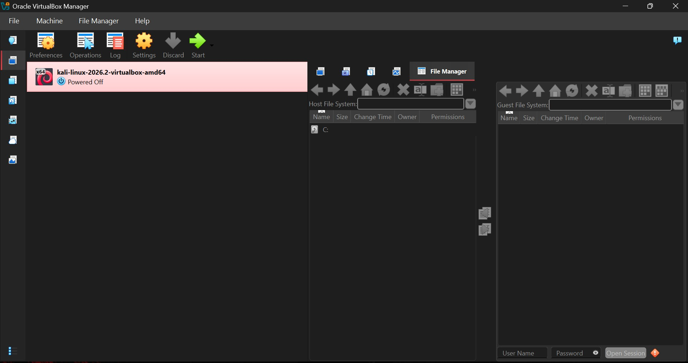
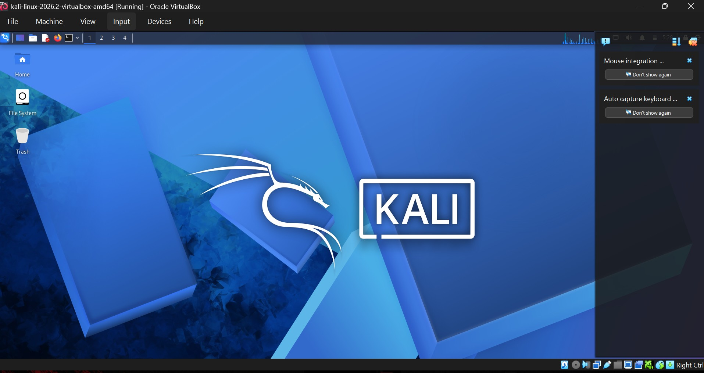

# 🔐 Cybersecurity Lab Environment Setup

  <strong>WEEK 1 | PROJECT MODULE 1</strong> 
  Practical Lab Environment Setup

  
  
  
  

---

## 📌 Project Overview

This project focuses on setting up a practical cybersecurity lab environment using Oracle VirtualBox and Kali Linux.

The purpose of the lab is to create a virtual environment where cybersecurity tools and practical exercises can be carried out safely without directly affecting the host computer.

Kali Linux was installed and successfully booted as a virtual machine using Oracle VirtualBox.

## 🎯 Project Objectives

The main objectives of this project were to:

- Set up Oracle VirtualBox as the virtualization platform.
- Create a virtual machine for Kali Linux.
- Install and boot the Kali Linux operating system.
- Prepare a virtual environment for future cybersecurity practical exercises.
- Become familiar with managing virtual machines.

## 🛠️ Tools and Technologies Used

| Tool | Purpose |
|---|---|
| Oracle VirtualBox | Virtualization platform used to create and manage the virtual machine |
| Kali Linux | Linux distribution designed for cybersecurity and penetration testing |
| Windows Host Machine | Physical computer used to run the virtual environment |

## 💻 Lab Environment

The practical lab environment consists of:

- **Virtualization Software:** Oracle VirtualBox
- **Operating System:** Kali Linux
- **Virtual Machine:** Kali Linux VM
- **Host Operating System:** Windows

## 📸 Project Screenshots

The following screenshots provide visual evidence of the lab setup.

### 1. VirtualBox Manager

This screenshot shows Oracle VirtualBox Manager with the Kali Linux virtual machine listed.

### 2. Kali Linux Desktop

This screenshot shows the Kali Linux desktop after successfully booting the virtual machine.

---

## ✅ Project Outcome

The initial practical lab setup was completed successfully.

- Oracle VirtualBox was installed and opened.
- A Kali Linux virtual machine was created.
- The Kali Linux virtual machine successfully booted.
- The Kali Linux desktop was accessible.

The screenshots above serve as evidence of the virtual machine setup and successful boot.

## 🧠 Skills Gained

Through this project, I gained practical experience in:

- Virtualization concepts.
- Virtual machine management.
- Kali Linux environment setup.
- Basic Linux desktop navigation.
- Preparing a virtual environment for cybersecurity practice.

## ⚠️ Project Notes

This project documents the initial lab setup and the visual evidence available.

Advanced network configurations, IP address verification, shared folders, clipboard integration, and other lab settings should only be marked as completed when they have been configured and independently verified.

## 🏁 Conclusion

This project provided the foundation for my practical cybersecurity learning journey.

Successfully setting up and booting Kali Linux in Oracle VirtualBox establishes a virtual environment for future hands-on exercises, security testing, and cybersecurity tool practice.

---

  <strong>Cybersecurity Learning Portfolio</strong> 
  Week 1 | Project Module 1

